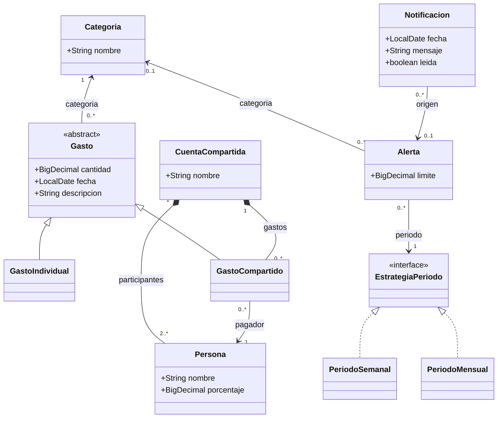

# Modelado

En este apartado se describen y explican las decisiones y actividades llevadas a cabo durante la etapa de modelado del proyecto.

Para representar el modelo de clases del dominio, hemos elegido **Mermaid**, una herramienta que permite crear diagramas mediante una sintaxis basada en texto. En concreto, utilizaremos su funcionalidad de diagramas de clases, que permite representar los elementos del dominio, sus atributos, operaciones y las relaciones existentes entre ellos.

Una de las principales ventajas de Mermaid es su sencillez y flexibilidad, ya que permite definir los diagramas directamente en archivos Markdown, sin necesidad de generar ni almacenar imágenes externas. Además, es compatible con **GitHub**, que puede representar automáticamente los diagramas **Mermaid** incluidos en los archivos Markdown, facilitando así su visualización.

El diagrama inicial del que partimos se muestra a continuación. En esta primera versión se presenta una estructura básica que contiene pocos elementos, esto es algo esperado en las primeras fases del desarrollo. A medida que avancemos en el proyecto,  iremos incorporando y refinando las clases, atributos y relaciones necesarias.

A continuación, se muestra el diagrama inicial de clases del dominio, que tomaremos como punto de partida para las siguientes versiones del modelado.

